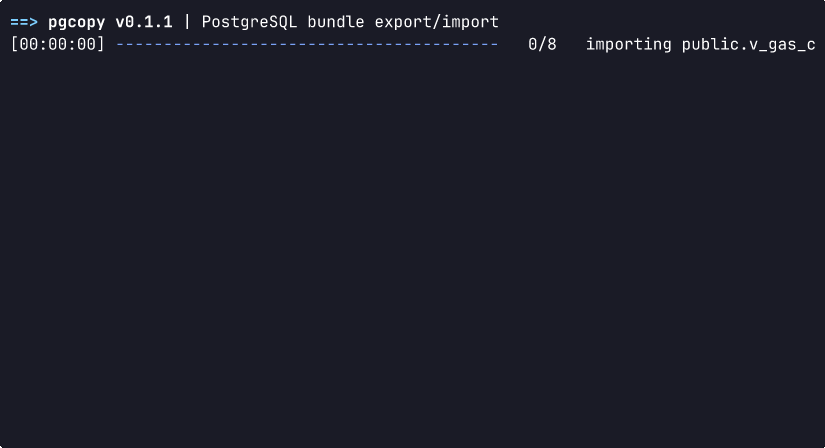

# pgcopy

[🇺🇸 English](./README.md) · [🇷🇺 Русский](./README.ru.md)

`pgcopy` is a command-line tool for moving selected PostgreSQL tables, views, and materialized views between databases. It can also describe the source schema (DDL) as compact context for writing SQL with an AI chat assistant when direct database access is unavailable.

By default, source objects become regular tables at the destination. A view can instead be preserved as a view with `export_as = "view"`.

## Features

- Export multiple PostgreSQL objects (tables, views, and more) into one `tar.zst` bundle.
- Import bundle data in `replace` or `append` mode, or create only the schema with `--ddl-only`.
- Export only selected columns and rows using a compact SQL-like configuration.
- Encrypt bundles with a password.
- Inspect bundle metadata without connecting to PostgreSQL.
- Generate Markdown, SQL, or JSON schema context for an AI chat assistant.

## Demo

### Export


### Import



## Installation

### Prebuilt binaries

Download the archive for your platform from [GitHub Releases](https://github.com/hexqnt/pgcopy/releases/latest):

| Platform                         | Archive suffix                     |
| -------------------------------- | ---------------------------------- |
| Linux x86-64 (glibc)             | `x86_64-unknown-linux-gnu.tar.gz`  |
| Linux x86-64 (static musl build) | `x86_64-unknown-linux-musl.tar.gz` |
| Windows x86-64                   | `x86_64-pc-windows-msvc.zip`       |
| macOS Apple Silicon              | `aarch64-apple-darwin.tar.gz`      |

On Linux or macOS, extract the archive and install the executable on your `PATH`:

```bash
tar -xzf pgcopy-vX.Y.Z-<target>.tar.gz
mkdir -p ~/.local/bin
install -m 755 pgcopy-vX.Y.Z-<target> ~/.local/bin/pgcopy
pgcopy --help
```

Replace `vX.Y.Z` and `<target>` with values from the downloaded filename, and ensure `~/.local/bin` is on your `PATH`.

On Windows, extract the ZIP and run the executable directly or rename it to `pgcopy.exe`:

```powershell
Expand-Archive -Path .\pgcopy-vX.Y.Z-x86_64-pc-windows-msvc.zip -DestinationPath .\pgcopy
Rename-Item .\pgcopy\pgcopy-vX.Y.Z-x86_64-pc-windows-msvc.exe pgcopy.exe
.\pgcopy\pgcopy.exe --help
```

### From source

Install the [Rust toolchain](https://rustup.rs/), then install `pgcopy` from a local clone:

```bash
git clone https://github.com/hexqnt/pgcopy.git
cd pgcopy
cargo install --locked --path .
pgcopy --help
```

Cargo installs into `~/.cargo/bin` by default; ensure it is on your `PATH`.

## Quick start

Create `config.toml` describing what to export:

```toml
[general]
data_format = "binary"
concurrency = 4

[[objects]]
select = "select * from public.orders"

[[objects]]
select = "select id, total_amount from public.invoices where paid = true"
target_schema = "archive"
target_name = "paid_invoices"
```

Set the PostgreSQL connection variables for the source database and export the bundle:

```bash
export PGHOST=source.example.com
export PGPORT=5432
export PGDATABASE=app_db
export PGUSER=app_user
export PGPASSWORD=secret

pgcopy export --config ./config.toml --out ./bundle.tar.zst
```

Point the variables at the destination database and import it:

```bash
export PGHOST=destination.example.com
export PGDATABASE=app_copy

pgcopy import --in ./bundle.tar.zst --mode replace
```

## Commands

```text
pgcopy export --config <config.toml> --out <bundle> [options]
pgcopy import --in <bundle> [options]
pgcopy info --in <bundle> [options]
pgcopy describe --config <config.toml> [options]
```

Run `pgcopy --help` or `pgcopy <command> --help` for the complete CLI reference.

### `export`

- `--config`: export configuration file.
- `--out`: destination bundle path.
- `--concurrency N`: number of objects exported concurrently. Resolution order: CLI, `general.concurrency`, `PGCOPY_CONCURRENCY`, then `1`.
- `--password`: bundle encryption passphrase; falls back to the `PASSWORD` environment variable.

### `import`

- `--in`: bundle created by `pgcopy export`.
- `--mode replace|append`: replace an existing target object (the default), or append to a compatible table.
- `--concurrency N`: number of objects imported concurrently; defaults to `1`.
- `--ddl-only`: create target objects without loading rows.
- `--password`: bundle decryption passphrase; falls back to `PASSWORD`.

### `info`

Reads a bundle without connecting to PostgreSQL:

```bash
pgcopy info --in ./bundle.tar.zst
pgcopy info --in ./bundle.tar.zst --objects
pgcopy info --in ./bundle.tar.zst --format json
```

### `describe`

Describes each unique source relation named by the config for use with an AI assistant. The complete relation is always described; projections, `WHERE`/`ORDER BY`/`LIMIT`, `target_schema`, and `target_name` are ignored.

```bash
pgcopy describe --config ./config.toml > schema-context.md
pgcopy describe --config ./config.toml --format sql --out schema-context.sql
pgcopy describe --config ./config.toml --format json --out schema-context.json
```

Markdown output includes the PostgreSQL version, ordered columns, types, nullability, defaults, identity/generated columns, constraints, enum values, database comments, view definitions, and warnings about foreign keys to objects outside the config. Use `--no-comments` to omit database comments, which are untrusted text.

Existing planner statistics can be included without reading table rows or changing the database:

```bash
pgcopy describe --config ./config.toml --statistics
pgcopy describe --config ./config.toml --statistics=5
pgcopy describe --config ./config.toml --statistics 5
```

Statistics may be approximate or stale. The optional number limits common values per column; this is explicit because those values may be sensitive. The command never runs `ANALYZE`.

After built-in rendering, `pgcopy` tries formatters from `PATH`: `markdownlint-cli2`/`markdownlint`/`prettier` for Markdown, `pg_format`/`sqlfluff` for SQL, and `biome`/`prettier`/`jq` for JSON. It stages input beside the output so local formatter configuration is found. If every formatter fails, it keeps the deterministic built-in output and warns on stderr. Use `--no-format` to disable external formatting and its warnings.

Global options include `--dry-run`, `--quiet`, and `--no-progress`.

## PostgreSQL connection

The `describe`, `export`, and `import` commands accept these connection options:

- `--host`
- `--port`
- `--dbname`
- `--username` (alias: `--user`)
- `--pgpassword`

The standard `PGHOST`, `PGPORT`, `PGDATABASE`, `PGUSER`, and `PGPASSWORD` variables are supported. Precedence is CLI, configuration file, environment, then defaults. Without an explicit password, `pgcopy` also checks `.pgpass`.

For `describe` and `export`, connection settings may be stored in `config.toml`. Values can reference environment variables as `{VARIABLE}`:

```toml
[connection]
host = "{MY_PGHOST}"
port = 5432
dbname = "analytics"
user = "reader"
password = "{MY_PGPASSWORD}"
```

Keeping passwords in environment variables or `.pgpass` is preferable to putting them on the command line or in the configuration file.

## Configuration

The export configuration contains optional general settings and one or more objects:

```toml
[general]
data_format = "binary"
compression = "zstd"
consistent_snapshot = true
concurrency = 4

[[objects]]
select = "select * from public.orders"

[[objects]]
select = "select * except (internal_note) from public.customers"
target_schema = "snapshot"
target_name = "customers"

[[objects]]
select = "select * from reporting.sales_daily"
export_as = "view"
```

### General settings

- `data_format`: `binary` (default) or `csv`.
- `compression`: currently `zstd`.
- `consistent_snapshot`: use a single consistent database snapshot; defaults to `true`.
- `concurrency`: number of concurrent export workers; defaults to `1`.

### Objects

- `select` identifies the source object and optionally selects columns, filters, ordering, and a row limit.
- `target_schema` and `target_name` rename the imported object. Set either both or neither.
- `export_as` is `table` by default. Use `view` to preserve a source view and automatically export its dependencies as tables.

Supported `select` forms include:

```sql
select * from schema.object
select col1, col2 from schema.object
select * except (col1, col2) from schema.object
select ... from schema.object where ... order by ... limit 100
```

The selector operates on one `schema.object`; joins and grouping are not supported. Clauses must appear in `WHERE`, `ORDER BY`, `LIMIT` order. For `export_as = "view"`, use exactly `select * from schema.object`.

## Compatibility notes

- Binary bundles require the source and destination to use the same PostgreSQL major version. Use `data_format = "csv"` when moving between major versions.
- Import bundles containing preserved views with `--concurrency 1`, so their dependencies are created in order.
- `replace` is atomic per object: a failed object import is rolled back.

## Bundle encryption

Pass a bundle password directly or through the `PASSWORD` environment variable:

```bash
pgcopy export --config ./config.toml --out ./bundle.age --password 'strong-passphrase'
pgcopy import --in ./bundle.age --password 'strong-passphrase'
```

Without a password, bundles are written unencrypted. An encrypted bundle requires the same password for `import` and `info`.
