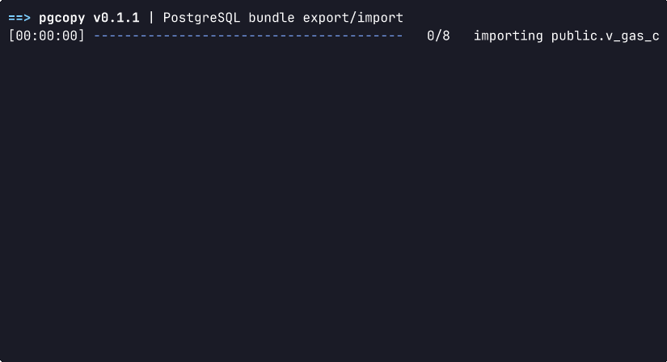

# pgcopy

[🇺🇸 English](./README.md) · [🇷🇺 Русский](./README.ru.md)

`pgcopy` — консольная утилита для переноса выбранных таблиц, представлений и материализованных представлений PostgreSQL между базами данных. Помимо прочего также умеет описывать исходную схему (DDL) как компактный контекст для написания SQL с AI-чатом, когда прямого доступа к БД нет.

По умолчанию исходные объекты создаются в целевой БД как обычные таблицы. Представление также можно сохранить с помощью `export_as = "view"`, как объект вьюшки.

## Возможности

- Экспорт нескольких объектов(таблиц, вьюшек, итд.) PostgreSQL в один `tar.zst` bundle-файл.
- Импорт данных из bundle-файла в режимах `replace` и `append`, а также создание только схемы через `--ddl-only`.
- Можно выгружать таблицы не полностью, выбирать колонки и строки с помощью компактной SQL-подобной конфигурации.
- Шифрование bundle-файлов паролем.
- Просмотр метаданных bundle без подключения к PostgreSQL.
- Генерация контекста схемы в Markdown, SQL или JSON для контекста AI-чата.

## Демо

### Экспорт


### Импорт



## Установка

### Готовые бинарники

Скачайте архив для своей платформы со страницы [GitHub Releases](https://github.com/hexqnt/pgcopy/releases/latest):

| Платформа                              | Суффикс архива                     |
| -------------------------------------- | ---------------------------------- |
| Linux x86-64 (glibc)                   | `x86_64-unknown-linux-gnu.tar.gz`  |
| Linux x86-64 (статическая сборка musl) | `x86_64-unknown-linux-musl.tar.gz` |
| Windows x86-64                         | `x86_64-pc-windows-msvc.zip`       |
| macOS Apple Silicon                    | `aarch64-apple-darwin.tar.gz`      |

В Linux или macOS распакуйте архив, переименуйте версионный бинарник и поместите его в каталог из `PATH`:

```bash
tar -xzf pgcopy-vX.Y.Z-<target>.tar.gz
mkdir -p ~/.local/bin
install -m 755 pgcopy-vX.Y.Z-<target> ~/.local/bin/pgcopy
pgcopy --help
```

Замените `vX.Y.Z` и `<target>` значениями из имени скачанного файла. Убедитесь, что `~/.local/bin` входит в `PATH`.

В Windows распакуйте ZIP и либо запускайте бинарник напрямую, либо переименуйте его в `pgcopy.exe` и перенесите в каталог из `PATH`:

```powershell
Expand-Archive -Path .\pgcopy-vX.Y.Z-x86_64-pc-windows-msvc.zip -DestinationPath .\pgcopy
Rename-Item .\pgcopy\pgcopy-vX.Y.Z-x86_64-pc-windows-msvc.exe pgcopy.exe
.\pgcopy\pgcopy.exe --help
```

### Из исходников

Установите [Rust toolchain](https://rustup.rs/), затем установите `pgcopy` из локального клона:

```bash
git clone https://github.com/hexqnt/pgcopy.git
cd pgcopy
cargo install --locked --path .
pgcopy --help
```

По умолчанию Cargo устанавливает бинарник в `~/.cargo/bin`; обычно этот каталог нужно добавить в `PATH`.

## Быстрый старт

Создайте `config.toml` с описанием экспортируемых объектов:

```toml
[general]
data_format = "binary"
concurrency = 4

[[objects]]
select = "select * from public.orders"

[[objects]]
select = "select id, total_amount from public.invoices where paid = true"
target_schema = "archive"
target_name = "paid_invoices"
```

Задайте стандартные переменные подключения к исходной базе PostgreSQL и экспортируйте bundle:

```bash
export PGHOST=source.example.com
export PGPORT=5432
export PGDATABASE=app_db
export PGUSER=app_user
export PGPASSWORD=secret

pgcopy export --config ./config.toml --out ./bundle.tar.zst
```

Переключите переменные на целевую базу и импортируйте bundle:

```bash
export PGHOST=destination.example.com
export PGDATABASE=app_copy

pgcopy import --in ./bundle.tar.zst --mode replace
```

## Команды

```text
pgcopy export --config <config.toml> --out <bundle> [options]
pgcopy import --in <bundle> [options]
pgcopy info --in <bundle> [options]
pgcopy describe --config <config.toml> [options]
```

Полная справка доступна через `pgcopy --help` и `pgcopy <command> --help`.

### `export`

- `--config`: файл конфигурации экспорта.
- `--out`: путь к создаваемому bundle.
- `--concurrency N`: число одновременно экспортируемых объектов. Приоритет значения: CLI, `general.concurrency`, `PGCOPY_CONCURRENCY`, затем `1`.
- `--password`: пароль шифрования bundle; если флаг не задан, используется переменная `PASSWORD`.

### `import`

- `--in`: bundle, созданный командой `pgcopy export`.
- `--mode replace|append`: заменить существующий объект (по умолчанию) или дописать данные в совместимую таблицу.
- `--concurrency N`: число одновременно импортируемых объектов; по умолчанию `1`.
- `--ddl-only`: создать целевые объекты без загрузки строк.
- `--password`: пароль расшифровки bundle; если флаг не задан, используется `PASSWORD`.

### `info`

Читает bundle без подключения к PostgreSQL:

```bash
pgcopy info --in ./bundle.tar.zst
pgcopy info --in ./bundle.tar.zst --objects
pgcopy info --in ./bundle.tar.zst --format json
```

### `describe`

Создаёт удобное для AI описание уникальных исходных relation, указанных в конфиге. Всегда описывает исходный объект целиком: проекция, `WHERE`/`ORDER BY`/`LIMIT`, `target_schema` и `target_name` игнорируются.

```bash
pgcopy describe --config ./config.toml > schema-context.md
pgcopy describe --config ./config.toml --format sql --out schema-context.sql
pgcopy describe --config ./config.toml --format json --out schema-context.json
```

Markdown по умолчанию включает версию PostgreSQL, колонки в физическом порядке, типы, nullable/default, identity/generated, ограничения, значения enum, комментарии БД, определения view/materialized view и предупреждения о внешних ключах на объекты вне конфига. Используйте `--no-comments`, если комментарии БД включать нельзя: это недоверенный текст.

Существующую статистику планировщика можно добавить без чтения строк и изменения БД:

```bash
pgcopy describe --config ./config.toml --statistics
pgcopy describe --config ./config.toml --statistics=5
pgcopy describe --config ./config.toml --statistics 5
```

Статистика приблизительна и может быть устаревшей. Необязательное число после `--statistics` задаёт максимальное количество частых значений на колонку. Оно указывается явно, потому что такие значения могут содержать чувствительные данные. Команда никогда не запускает `ANALYZE`.

После встроенного рендеринга `pgcopy` по порядку пробует поддерживаемые форматтеры из `PATH`: `markdownlint-cli2`/`markdownlint`/`prettier` для Markdown, `pg_format`/`sqlfluff` для SQL и `biome`/`prettier`/`jq` для JSON. Временный входной файл создаётся рядом с выходным, поэтому форматтер может найти локальную конфигурацию проекта. Ошибка форматтера не приводит к потере результата: `pgcopy` пробует следующий вариант, а в крайнем случае сохраняет встроенный вывод и пишет предупреждение в stderr. Флаг `--no-format` отключает внешнее форматирование и все связанные с ним предупреждения. Встроенный рендеринг остаётся детерминированным и не требует внешних инструментов.

Общие флаги: `--dry-run`, `--quiet` и `--no-progress`.

## Подключение к PostgreSQL

Команды `describe`, `export` и `import` принимают следующие параметры подключения:

- `--host`
- `--port`
- `--dbname`
- `--username` (алиас: `--user`)
- `--pgpassword`

Также поддерживаются стандартные переменные `PGHOST`, `PGPORT`, `PGDATABASE`, `PGUSER` и `PGPASSWORD`. Значения CLI имеют приоритет над конфигурационным файлом, а значения файла — над переменными окружения и значениями по умолчанию. Если пароль явно не задан, `pgcopy` также проверяет стандартный файл `.pgpass`.

Для `describe` и `export` параметры подключения можно хранить в `config.toml`. Значения могут ссылаться на переменные окружения в виде `{VARIABLE}`:

```toml
[connection]
host = "{MY_PGHOST}"
port = 5432
dbname = "analytics"
user = "reader"
password = "{MY_PGPASSWORD}"
```

Пароли лучше хранить в переменных окружения или `.pgpass`, а не передавать в командной строке или записывать в конфигурацию.

## Конфигурация

Конфигурация экспорта содержит необязательные общие настройки и один или несколько объектов:

```toml
[general]
data_format = "binary"
compression = "zstd"
consistent_snapshot = true
concurrency = 4

[[objects]]
select = "select * from public.orders"

[[objects]]
select = "select * except (internal_note) from public.customers"
target_schema = "snapshot"
target_name = "customers"

[[objects]]
select = "select * from reporting.sales_daily"
export_as = "view"
```

### Общие настройки

- `data_format`: `binary` (по умолчанию) или `csv`.
- `compression`: сейчас поддерживается `zstd`.
- `consistent_snapshot`: чтение из одного согласованного снимка БД; по умолчанию `true`.
- `concurrency`: число параллельных обработчиков экспорта; по умолчанию `1`.

### Объекты

- `select` задаёт исходный объект и при необходимости выбирает колонки, фильтр, сортировку и ограничение строк.
- `target_schema` и `target_name` переименовывают импортируемый объект. Нужно задать либо оба поля, либо ни одного.
- `export_as` по умолчанию равен `table`. Значение `view` сохраняет исходное представление и автоматически экспортирует его зависимости как таблицы.

Поддерживаемые формы `select`:

```sql
select * from schema.object
select col1, col2 from schema.object
select * except (col1, col2) from schema.object
select ... from schema.object where ... order by ... limit 100
```

Селектор работает с одним `schema.object`; `JOIN` и группировка не поддерживаются. Выражения должны идти в порядке `WHERE`, `ORDER BY`, `LIMIT`. Для `export_as = "view"` используйте строго `select * from schema.object`.

## Совместимость

- Для bundle в формате `binary` исходная и целевая БД должны использовать одну мажорную версию PostgreSQL. Для переноса между разными версиями используйте `data_format = "csv"`.
- Bundle с сохранёнными представлениями импортируйте с `--concurrency 1`, чтобы зависимости создавались в нужном порядке.
- Режим `replace` атомарен для каждого объекта: неудачный импорт объекта откатывается.

## Шифрование bundle

Передайте пароль напрямую или через переменную окружения `PASSWORD`:

```bash
pgcopy export --config ./config.toml --out ./bundle.age --password 'strong-passphrase'
pgcopy import --in ./bundle.age --password 'strong-passphrase'
```

Без пароля bundle создаётся незашифрованным. Для команд `import` и `info` с зашифрованным bundle нужен тот же пароль.
